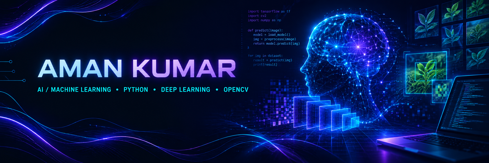

 

 

---
👨‍💻 About Me
Hi, I'm Aman Kumar, a Computer Science and Engineering student focused on Artificial Intelligence and Machine Learning.
🧠 Learning and building with Machine Learning and Deep Learning
🐍 Working with Python and data tools such as NumPy and Pandas
👁️ Exploring computer vision and image processing with OpenCV
🧪 Practising model training, evaluation, and practical ML workflows
🌱 Improving my programming fundamentals and problem-solving skills
🤝 Open to learning, project collaboration, and beginner-friendly open source
> *Curious mind. Practical projects. Consistent progress.*
---
⚡ Tech Stack

Libraries & concepts:  
`NumPy` · `Pandas` · `Matplotlib` · `Seaborn` · `Scikit-learn` · `CNN` · `Image Processing` · `Model Evaluation`
---
🚀 Featured Projects
👁️ OpenCV Projects
A hands-on collection of computer-vision exercises, including image reading and resizing, webcam interaction, filters, edge detection, thresholding, contours, morphology, and Haar Cascade detection.
Tech: Python · OpenCV · NumPy

🎓 Student Stress Prediction System
A machine-learning project exploring student stress-level prediction from academic, lifestyle, and questionnaire-related features. The project has included experiments with classification models and a Streamlit interface.
Tech: Python · Pandas · Scikit-learn · Streamlit
Status: under development. Repository link will be added when the project is published publicly.
🌿 FasalMitra — Crop Disease Detection
A B.Tech project exploring lightweight CNN-based crop disease detection for offline mobile use in low-connectivity rural areas, using MobileNetV2 as the model direction.
Tech: Python · CNN · MobileNetV2 · TensorFlow/Keras
Status: project development and mobile integration are ongoing. Public repository link to be added when available.
---
📊 GitHub Analytics

  

---
🐍 Contribution Snake

---
📬 Connect

Open to learning, thoughtful collaboration, and building useful projects.
💜 Code · Learn · Build · Repeat

